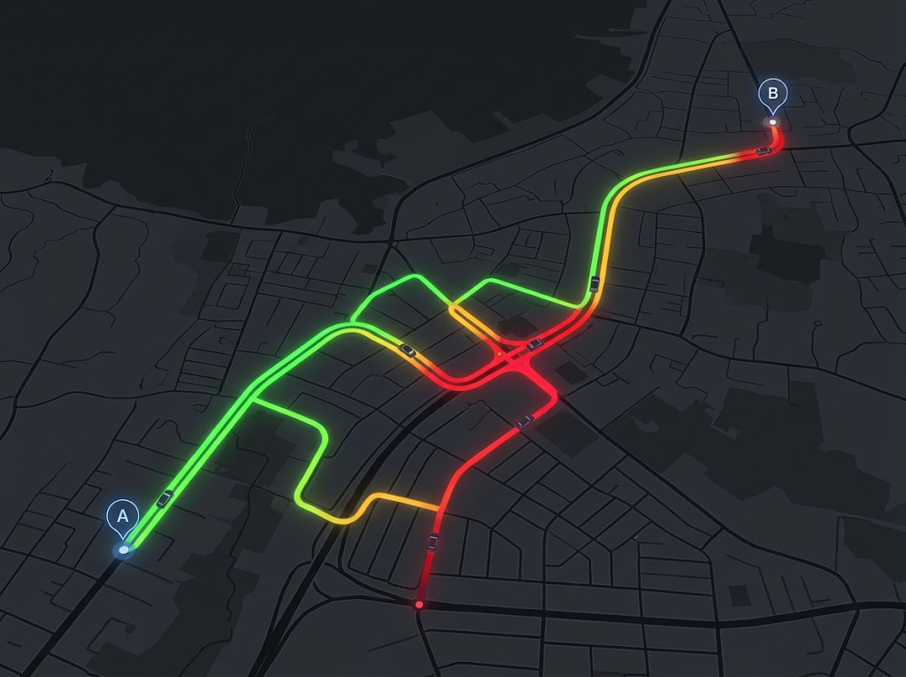

Project ini menggunakan bantuan AI Gemini untuk bantuan refactoring & routing screen (1), implementasi validasi email dan password (2), dan generate gambar placeholder map untuk screen trips (3)

---
01 Refactor index.tsx
https://share.gemini.google/mdbOLBepbCRm

User prompt: saya sedang membuat app react native menggunakan expo bernama "gaspas" untuk mencatat trip analytics dan menghitung harga bensin/perjalanan dalam sehari. Saya ingin menayakan beberapa pertanyaan dasar dahulu
Response: Silakan! Anda bisa menanyakan pertanyaan dasarnya terlebih dahulu.
Baik mengenai struktur arsitektur React Native/Expo, integrasi alur perhitungan bensin, manajemen state lokal vs database, penanganan geolokasi/API peta, atau optimasi UI, silakan sampaikan mana yang ingin dibahas pertama kali.

User prompt: dalam struktur file ku dibawah src/app/ terdapat index.tsx (login/register) dan dashboard.tsx untuk home screennya. Jika mengikuti industry standard, index.tsx digunakan hanya sebagai penghubung antar screen atau digunakan untuk login/register
Response: Mengikuti standar industri (terutama saat menggunakan Expo Router berbasis file-based routing), src/app/index.tsx tidak disarankan diisi langsung dengan kode komponen Login/Register.
index.tsx di akar direktori app/ idealnya berfungsi sebagai penghubung, pengarah (redirector), atau gerbang utama yang memeriksa status autentikasi pengguna.
Praktik Standar Struktur File Expo Router
Untuk memisahkan tanggung jawab layar (separation of concerns) dengan rapi, struktur alur autentikasi dan dasbor umumnya disusun seperti ini:
src/
└── app/
    ├── _layout.tsx      # Entry point layout global (penyedia auth context/state)
    ├── index.tsx        # Gateway / Auth check redirector
    ├── (auth)/          # Group route khusus guest / belum login
    │   ├── _layout.tsx
    │   ├── login.tsx
    │   └── register.tsx
    └── (main)/         # Group route khusus user terautentikasi
        ├── _layout.tsx
        └── dashboard.tsx

Alasan & Peran Masing-Masing File
Peran src/app/index.tsx (Gateway/Redirector)
Berfungsi menentukan pengguna harus diarahkan ke mana saat aplikasi dibuka.
Mengecek status autentikasi (misal via token/state isLoggedIn).
Jika belum login → Redirect ke /(auth)/login.
Jika sudah login → Redirect ke /(main)/dashboard.
Contoh implementasi src/app/index.tsx:import { Redirect } from 'expo-router';
import { useAuth } from '@/context/AuthContext'; // Misal state management auth Anda

export default function Index() {
  const { isAuthenticated, isLoading } = useAuth();

  if (isLoading) {
    return null; // Atau tampilkan SplashScreen / Loading indicator
  }

  if (!isAuthenticated) {
    return <Redirect href="/(auth)/login" />;
  }

  return <Redirect href="/(main)/dashboard" />;
}

Gunakan Group Routes (auth) dan (main)
Tanda kurung () menandakan folder tersebut tidak akan memengaruhi URL/path navigasi.
Memudahkan pemisahan layout. Misalnya, layar di folder (auth) tidak memiliki navigasi bawah (bottom tabs), sedangkan layar di folder (main) memiliki bottom tabs atau drawer.

User prompt: mengapa ada 2 layout.tsx?
Response: Adanya dua file _layout.tsx (atau lebih) terjadi karena Expo Router menggunakan konsep Nested Layouts (Layout Bersarang). Setiap folder dalam struktur app/ dapat memiliki _layout.tsx sendiri untuk mengatur tampilan dan perilaku navigasi khusus pada grup layar di dalam folder tersebut.
Perbedaan Peran Masing-Masing Layout
Root Layout (src/app/_layout.tsx) Bertindak sebagai pembungkus tingkat paling atas untuk seluruh aplikasi.
Tempat mendaftarkan Provider global (misalnya AuthContext, ThemeProvider, atau React Query).
Mengatur Splash Screen awal.
Menyediakan elemen UI yang berlaku universal di seluruh aplikasi (seperti Global Toast atau Modal global).
Group Layout (src/app/(auth)/_layout.tsx & src/app/(main)/_layout.tsx) Bertindak sebagai pengatur navigasi khusus untuk kelompok layar tertentu.
Layout (auth): Menggunakan <Stack/> tanpa header atau navigasi bawah, khusus untuk layar Login dan Register agar tampilan bersih.
Layout (main): Menggunakan <Tabs/> atau <Drawer/> khusus untuk area aplikasi setelah pengguna berhasil login, sehingga navigasi bawah tetap terlihat saat pengguna berpindah antara Dasbor, Analytics, atau Profil.
Gambaran Hirarki Visual
[ Root _layout.tsx ] -> Membawa AuthContext & Global Setup
       │
       ├── Jika Belum Login ──> [ (auth)/_layout.tsx ] -> Stack Navigation (Tanpa Tabs)
       │                               ├── login.tsx
       │                               └── register.tsx
       │
       └── Jika Sudah Login ──> [ (main)/_layout.tsx ] -> Tab Navigation (Ada Bottom Bar)
                                       ├── dashboard.tsx (Home Tab)
                                       └── analytics.tsx (Analytics Tab)

Dengan memisahkan _layout.tsx, UI khusus layar utama (seperti bottom navigation bar) tidak akan menyebar atau bocor ke layar Login/Register.

User prompt: untuk main dan auth itu berarti dalam bentuk folder?
Response: Ya, (auth) dan (main) adalah nama folder di dalam direktori src/app/.
Tanda kurung () pada nama folder tersebut merupakan fitur khusus Expo Router yang disebut Group Routes (Route Groups).
Efek Penggunaan Tanda Kurung () pada Folder
Mengelompokkan File Tanpa Mengubah URL/Path Navigasi
Folder biasa src/app/auth/login.tsx → jalurnya menjadi /auth/login.
Folder group src/app/(auth)/login.tsx → jalurnya tetap /login.
Folder () disembunyikan dari struktur URL navigasi, sehingga URL aplikasi tetap bersih.
Memisolasi Layout Navigasi
Semua file .tsx di dalam folder (auth)/ akan otomatis mewarisi tata letak dari src/app/(auth)/_layout.tsx.
Semua file .tsx di dalam folder (main)/ akan otomatis mewarisi tata letak dari src/app/(main)/_layout.tsx.
Visualisasi Struktur Folder Fizik
Struktur direktori pada proyek Anda akan terlihat seperti ini:
src/
└── app/
    ├── _layout.tsx         <-- File Root Layout
    ├── index.tsx           <-- File Gateway / Auth check
    │
    ├── (auth)/             <-- FOLDER Group Auth
    │   ├── _layout.tsx     <-- Layout khusus Login/Register (Stack)
    │   ├── login.tsx       <-- Akses via path: /login
    │   └── register.tsx    <-- Akses via path: /register
    │
    └── (main)/            <-- FOLDER Group Utama
        ├── _layout.tsx     <-- Layout khusus Dasbor/Fitur (Tabs/Drawer)
        ├── dashboard.tsx   <-- Akses via path: /dashboard
        └── analytics.tsx   <-- Akses via path: /analytics

User prompt: bagaimana cara generate _layout.tsx?
Response: File _layout.tsx adalah file TypeScript React Native biasa yang mengekspor komponen React sebagai default export. Untuk membuatnya, Anda cukup membuat file baru secara manual di dalam direktori target dan mengisinya dengan komponen navigasi dari expo-router.
1. Root Layout (src/app/_layout.tsx)
Layout utama di tingkat teratas berfungsi membungkus seluruh aplikasi dengan <Stack/> global dan provider state (seperti Auth Provider).
import { Stack } from 'expo-router';

export default function RootLayout() {
  return (
    <Stack screenOptions={{ headerShown: false }}>
      {/* Slot internal untuk merender (auth), (main), atau index.tsx */}
      <Stack.Screen name="index" />
      <Stack.Screen name="(auth)" />
      <Stack.Screen name="(main)" />
    </Stack>
  );
}

2. Auth Layout (src/app/(auth)/_layout.tsx)
Layout khusus grup autentikasi ini mengatur navigasi bertumpuk (stack navigation) untuk layar Login dan Register tanpa bilah navigasi atas (header).
import { Stack } from 'expo-router';

export default function AuthLayout() {
  return (
    <Stack
      screenOptions={{
        headerShown: false,
        animation: 'slide_from_right',
      }}
    >
      <Stack.Screen name="login" />
      <Stack.Screen name="register" />
    </Stack>
  );
}

3. Main Layout (src/app/(main)/_layout.tsx)
Layout grup utama menggunakan navigasi tab bawah (bottom tabs) untuk memfasilitasi perpindahan antar-layar utama seperti Dashboard dan Analytics.
import { Tabs } from 'expo-router';
import { Ionicons } from '@expo/vector-icons';

export default function MainLayout() {
  return (
    <Tabs
      screenOptions={{
        headerShown: true,
        tabBarActiveTintColor: '#007AFF',
      }}
    >
      <Tabs.Screen
        name="dashboard"
        options={{
          title: 'Dashboard',
          tabBarIcon: ({ color, size }) => (
            <Ionicons name="car-outline" size={size} color={color} />
          ),
        }}
      />
      <Tabs.Screen
        name="analytics"
        options={{
          title: 'Analytics',
          tabBarIcon: ({ color, size }) => (
            <Ionicons name="stats-chart-outline" size={size} color={color} />
          ),
        }}
      />
    </Tabs>
  );
}

Ringkasan Pembuatan File
Buat file _layout.tsx di folder src/app/, src/app/(auth)/, atau src/app/(main)/.
Impor komponen navigasi dari expo-router (Stack atau Tabs).
Ekspor fungsi komponen React sebagai export default. Expo Router akan merender layar-layar di dalam folder tersebut sesuai konfigurasi <Stack/> atau <Tabs/>.

User prompt: explain these errors: [{     "resource": "/d:/03-projects/React/my-app/src/app/(main)/_layout.tsx",     "owner": "typescript",     "code": "2322",     "severity": 8,     "message": "Type '____ColorValue_Internal' is not assignable to type 'string | NativeColorValue | undefined'.\n  Type 'null' is not assignable to type 'string | NativeColorValue | undefined'.",     "source": "ts",     "startLineNumber": 17,     "startColumn": 54,     "endLineNumber": 17,     "endColumn": 59,     "relatedInformation": [         {             "startLineNumber": 23,             "startColumn": 5,             "endLineNumber": 23,             "endColumn": 10,             "message": "The expected type comes from property 'color' which is declared here on type 'IntrinsicAttributes & IntrinsicClassAttributes<Component<IconProps<\"key\" | \"search\" | \"repeat\" | \"link\" | \"at\" | \"push\" | \"map\" | \"filter\" | \"options\" | \"analytics\" | \"image\" | \"text\" | \"alert\" | ... 1343 more ... | \"woman-sharp\">, {}, any>> & Pick<...> & InexactPartial<...> & InexactPartial<...>'",             "resource": "/d:/03-projects/React/my-app/node_modules/@expo/vector-icons/build/createIconSet.d.ts"         }     ],     "modelVersionId": 3,     "origin": "extHost1" },{     "resource": "/d:/03-projects/React/my-app/src/app/(main)/_layout.tsx",     "owner": "typescript",     "code": "2322",     "severity": 8,     "message": "Type '____ColorValue_Internal' is not assignable to type 'string | NativeColorValue | undefined'.\n  Type 'null' is not assignable to type 'string | NativeColorValue | undefined'.",     "source": "ts",     "startLineNumber": 26,     "startColumn": 62,     "endLineNumber": 26,     "endColumn": 67,     "relatedInformation": [         {             "startLineNumber": 23,             "startColumn": 5,             "endLineNumber": 23,             "endColumn": 10,             "message": "The expected type comes from property 'color' which is declared here on type 'IntrinsicAttributes & IntrinsicClassAttributes<Component<IconProps<\"key\" | \"search\" | \"repeat\" | \"link\" | \"at\" | \"push\" | \"map\" | \"filter\" | \"options\" | \"analytics\" | \"image\" | \"text\" | \"alert\" | ... 1343 more ... | \"woman-sharp\">, {}, any>> & Pick<...> & InexactPartial<...> & InexactPartial<...>'",             "resource": "/d:/03-projects/React/my-app/node_modules/@expo/vector-icons/build/createIconSet.d.ts"         }     ],     "modelVersionId": 3,     "origin": "extHost1" }]
Response: Error tersebut terjadi karena variabel color yang diteruskan ke properti color pada komponen ikon (@expo/vector-icons) bernilai null atau terinfeksi tipe data yang dapat bernilai null, sedangkan ikon tersebut mewajibkan nilai string (seperti "#007AFF") atau undefined.
Penyebab Utama
Pada file src/app/(main)/_layout.tsx baris 17 dan 26, Anda kemungkinan menuliskan callback tabBarIcon seperti berikut:
// CONTOH KODE YANG MENYEBABKAN ERROR:
tabBarIcon: ({ color, size }) => (
  <Ionicons name="car-outline" size={size} color={color} /> // <-- TS Error 2322
)

Error TypeScript TS2322 (Type 'null' is not assignable to type ...) ini muncul akibat dua kemungkinan kondisi:
Konfigurasi tabBarActiveTintColor atau tabBarInactiveTintColor diisi null di dalam screenOptions.
Properti color yang diberikan oleh tabBarIcon terinferensi mengandung null dari tema (theme provider) atau state management yang sedang aktif.
Solusi Perbaikan
Terdapat tiga cara untuk menyelesaikannya:
1. Berikan Fallback Value / Default Color (Direkomendasikan)
Gunakan operator nullish coalescing (??) agar jika color bernilai null, komponen akan menggunakan warna cadangan dalam bentuk string.
tabBarIcon: ({ color, size }) => (
  <Ionicons 
    name="car-outline" 
    size={size} 
    color={color ?? '#8E8E93'} // Memberikan warna fallback jika color bernilai null
  />
)

2. Pastikan tabBarActiveTintColor Memiliki Nilai String Valid
Periksa bagian screenOptions pada Tabs. Pastikan tidak ada properti warna yang diatur ke null atau bernilai null dari variabel lain.
<Tabs
  screenOptions={{
    headerShown: true,
    tabBarActiveTintColor: '#007AFF', // Pastikan berupa string hex/rgb, bukan null
    tabBarInactiveTintColor: '#8E8E93',
  }}
>

3. Gunakan Type Assertion (Jika Yakin color Pasti String)
Jika Anda yakin warna dari Expo Router tidak akan pernah null saat runtime:
tabBarIcon: ({ color, size }) => (
  <Ionicons 
    name="car-outline" 
    size={size} 
    color={color as string} // Memaksa TypeScript menganggapnya sebagai string
  />
)

--- 

02 Email & phone validation
https://share.gemini.google/NUZura5JpChF

User prompt: bagaimana cara membuat input validation email dan passwords sederhana menggunakan react
Response: Untuk membuat validasi input email dan kata sandi sederhana di React, Anda bisa memanfaatkan state lokal (useState) untuk menyimpan nilai input serta pesan kesalahan (error message).
Berikut adalah contoh komponen sederhana yang memvalidasi format email (menggunakan regular expression) dan panjang kata sandi (minimal 8 karakter):
import React, { useState } from 'react';

function FormValidasi() {
  const [formData, setFormData] = useState({
    email: '',
    password: '',
  });

  const [errors, setErrors] = useState({
    email: '',
    password: '',
  });

  const handleChange = (e) => {
    const { name, value } = e.target;
    setFormData({
      ...formData,
      [name]: value,
    });
  };

  const validateForm = () => {
    let isValid = true;
    const newErrors = { email: '', password: '' };

    // Validasi Email
    const emailRegex = /^[^\s@]+@[^\s@]+\.[^\s@]+$/;
    if (!formData.email) {
      newErrors.email = 'Email tidak boleh kosong.';
      isValid = false;
    } else if (!emailRegex.test(formData.email)) {
      newErrors.email = 'Format email tidak valid.';
      isValid = false;
    }

    // Validasi Password
    if (!formData.password) {
      newErrors.password = 'Kata sandi tidak boleh kosong.';
      isValid = false;
    } else if (formData.password.length < 8) {
      newErrors.password = 'Kata sandi minimal 8 karakter.';
      isValid = false;
    }

    setErrors(newErrors);
    return isValid;
  };

  const handleSubmit = (e) => {
    e.preventDefault();
    if (validateForm()) {
      console.log('Form berhasil dikirim:', formData);
      alert('Form berhasil dikirim!');
    }
  };

  return (
    <form onSubmit={handleSubmit} style={{ maxWidth: '300px', margin: 'auto' }}>
      

        <label htmlFor="email">Email</label>
        <input
          type="email"
          id="email"
          name="email"
          value={formData.email}
          onChange={handleChange}
          style={{ width: '100%', display: 'block', padding: '8px', marginTop: '5px' }}
        />
        {errors.email && {errors.email}}
      

      

        <label htmlFor="password">Kata Sandi</label>
        <input
          type="password"
          id="password"
          name="password"
          value={formData.password}
          onChange={handleChange}
          style={{ width: '100%', display: 'block', padding: '8px', marginTop: '5px' }}
        />
        {errors.password && {errors.password}}
      

      <button type="submit" style={{ padding: '10px 15px', cursor: 'pointer' }}>
        Daftar
      </button>
    </form>
  );
}

export default FormValidasi;

Penjelasan alur kerja kode di atas:
formData digunakan untuk mengontrol nilai input email dan password (controlled components).
errors menyimpan pesan kesalahan secara terpisah untuk setiap field.
validateForm memeriksa aturan format email via Regex dan panjang kata sandi sebelum form dikirimkan (submit).
Jika terdapat kesalahan, fungsi mengembalikan nilai false dan menampilkan pesan di bawah input terkait.

User prompt: jelaskan regex berikut: /^[^\s@]+@[^\s@]+\.[^\s@]+$/
Response: Regex /^[^\s@]+@[^\s@]+\.[^\s@]+$/ digunakan untuk mengecek apakah sebuah string memiliki format dasar email yang valid (seperti nama@domain.com).
Berikut adalah pembagian komponen dan penjelasannya:
/ ... / Penanda awal dan akhir dari ekspresi reguler (regex) dalam JavaScript.
^ Menandakan awal dari string. Pencocokan harus dimulai dari karakter pertama.
[^\s@]+ Mencari satu atau lebih karakter yang bukan spasi (\s) dan bukan simbol @. Ini digunakan untuk memvalidasi bagian nama pengguna (username) sebelum simbol @.
@ Harus terdapat persis satu karakter @ secara harfiah.
[^\s@]+ Mencari satu atau lebih karakter setelah @ yang bukan spasi dan bukan simbol @. Ini merepresentasikan nama domain (misalnya gmail atau yahoo).
\. Karakter titik harfiah (.). Karakter titik harus diberi backslash (\) karena dalam regex titik polos memiliki arti "karakter apa saja".
[^\s@]+ Mencari satu atau lebih karakter setelah titik yang bukan spasi dan bukan simbol @. Ini merepresentasikan ekstensi domain (seperti com, id, atau org).
$ Menandakan akhir dari string. Memastikan tidak ada karakter tambahan setelah ekstensi domain.
Contoh hasil pencocokan:
user@example.com → Valid
user.name@domain.co.id → Valid
user@.com → Tidak Valid (tidak ada karakter domain sebelum titik)
user @example.com → Tidak Valid (mengandung karakter spasi)

User prompt: fungsi ini untuk apa?
Response: Potongan kode tersebut bertugas untuk memperbarui state error dan mengembalikan status kelayakan form (validity status) setelah proses validasi selesai dijalankan.
Fungsi baris per barisnya adalah sebagai berikut:
setErrors(newErrors); Memperbarui state errors dengan objek newErrors yang baru saja diisi. Jika terdapat pesan kesalahan (seperti email salah format atau password kurang dari 8 karakter), React akan merender ulang komponen dan menampilkan pesan error tersebut tepat di bawah input terkait. Jika tidak ada kesalahan, objek newErrors akan berisi string kosong sehingga pesan error sebelumnya dihilangkan.
return isValid; Mengembalikan nilai boolean (true atau false) ke pemanggil fungsi tersebut, yaitu handleSubmit.
true menandakan bahwa seluruh baris input sudah memenuhi aturan validasi.
false menandakan bahwa terdapat minimal satu input yang tidak sesuai aturan.
Di dalam fungsi handleSubmit, nilai balikan ini digunakan dalam percabangan kondisi:
if (validateForm()) {
  // Hanya dieksekusi jika isValid bernilai true
  console.log('Form berhasil dikirim:', formData);
}

Dengan alur ini, data form tidak akan dikirimkan atau diproses lebih lanjut jika validateForm() mengembalikan nilai false.

---
03 Generate placeholder gambar map
https://share.gemini.google/QeR4BtD9xwjs

User prompt: saya sedang membuat app react native menggunakan expo bernama "gaspas" untuk mencatat trip analytics dan menghitung harga bensin/perjalanan dalam sehari. Buatkan tampilan maps untuk melacak history rute mobil dari poin A ke poin B, visualisasikan kemacetan dengan warna hijau, kuning, dan merah. Generate maps saja dengan style minimalis, tanpa UI

Response: Berikut adalah visualisasi peta minimalis tanpa UI untuk aplikasi React Native "Gaspas". Gambar ini menampilkan riwayat rute mobil dari poin A ke poin B dengan visualisasi kemacetan menggunakan warna hijau, kuning, dan merah di atas peta berbayang gelap (dark mode). Anda dapat menggunakannya sebagai mockup atau referensi visual untuk pengerjaan map styling di aplikasi Anda.

