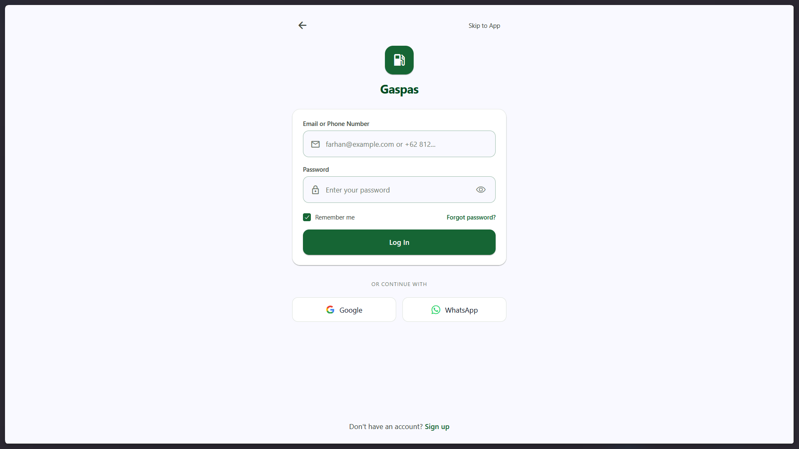
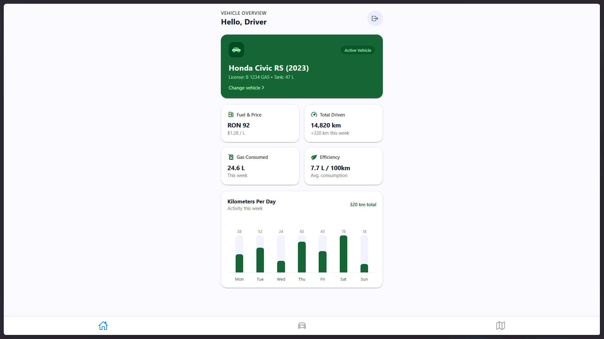
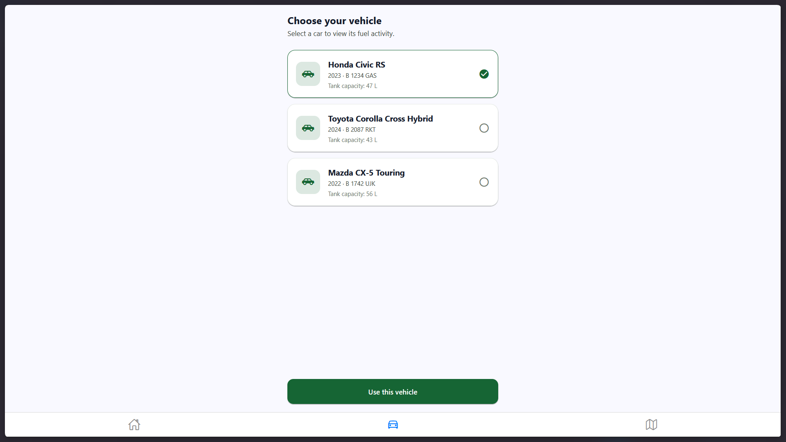
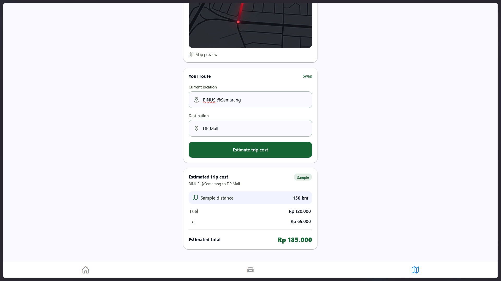

Gregorius Andrew Rahardja 2802418090

Video Demo and AI Usage Logs & Screenshots: https://drive.google.com/drive/folders/1575yGx3P3bPbOhLl5SHIXWnve-4hGAkQ?usp=sharing

# Gaspas

Gaspas merupakan aplikasi untuk mencatat trip analytics dan menghitung trip cost berbasis React Native dan Expo SDK 58. Project ini dirancang untuk membantu user memantau kendaraan dan merencanakan estimasi biaya perjalanan secara akurat.






---

## [LO 1 – 5 Points] Penjelasan Konsep

### 1. Cara Kerja React Native
React Native merupakan framework berbasis JavaScript dan React untuk membangun aplikasi mobile multiplatform (Android dan iOS) dengan menggunakan cukup satu codebase. React Native tidak merender HTML di dalam browser internal, melainkan merender komponen native UI ke platform target.

Arsitektur react native mengeksekusi logika aplikasi di *JavaScript Thread* dan interface di *UI/Native Thread*. Keduanya berkomunikasi melalui *Bridge* asinkron atau *New Architecture* menggunakan JSI (*JavaScript Interface*), Fabric Renderer, dan TurboModules. Instruksi JavaScript dieksekusi langsung ke kode native C++ tanpa serialisasi JSON berat sehingga animasi stabil 60 FPS dan performa setara aplikasi native.

### 2. Keunggulan React Native untuk Aplikasi Hybrid
1. Mengompilasi JSX langsung menjadi elemen interface native OS (seperti `UIView` di iOS dan `ViewGroup` di Android) sehingga jauh lebih responsive dan gestur sentuh yang jauh lebih halus dibanding WebView.
2. Developer dapat membagikan 85–95% logika bisnis dan tampilan untuk Android, iOS, serta Web, sehingga siklus pengembangan dan biaya pemeliharaan dapat diminimalisir.
3. Fitur *Fast Refresh* memperbarui kode secara langsung di layar tanpa me-reset state aplikasi. Integrasi fitur hardware seperti kamera, lokasi, dan sensor akselerometer menjadi sangat cepat dan terstandarisasi dengan adanya library npm dan Expo SDK.

### 3. Komponen, Props, State, dan Navigasi
- **Komponen:** Merupakan unit modular penyusun interface yang mengembalikan elemen visual JSX.
- **Props:** Argumen atau data *read-only* dari komponen induk ke anak untuk konfigurasi data.
- **State:** Merupakan data internal reaktif. Perubahan state dilakukan via *setter* yang mengakibatkan render ulang otomatis.
- **Navigasi:** Merupakan transisi antar screen (Stack bertingkat atau Tabs bawah), seperti yang dikelola oleh Expo Router.

### 4. Contoh Kode Implementasi Konsep
```tsx
import React, { useState } from 'react';
import { View, Text, TouchableOpacity, StyleSheet } from 'react-native';
import { useRouter } from 'expo-router';

// 1. Props
interface FuelProps {
  vehicle: string;
  initialFuel: number;
}

// 2. Komponen
export function FuelWidget({ vehicle, initialFuel }: FuelProps) {
  // 3. State (Data dinamis reaktif)
  const [fuel, setFuel] = useState<number>(initialFuel);
  
  // 4. Navigasi
  const router = useRouter();

  return (
    <View style={styles.card}>
      <Text style={styles.title}>{vehicle}</Text>
      <Text>Tingkat BBM: {fuel}%</Text>
      
      <TouchableOpacity onPress={() => setFuel(100)}>
        <Text style={styles.link}>Isi Tangki Penuh</Text>
      </TouchableOpacity>

      <TouchableOpacity onPress={() => router.push('/(main)/(tabs)/trips')}>
        <Text style={styles.navLink}>Rencanakan Perjalanan &rarr;</Text>
      </TouchableOpacity>
    </View>
  );
}

const styles = StyleSheet.create({
  card: { padding: 16, borderRadius: 12, backgroundColor: '#f4f6f4' },
  title: { fontSize: 16, fontWeight: 'bold' },
  link: { color: '#216c2e', marginVertical: 4 },
  navLink: { color: '#005ac1', marginTop: 4 },
});
```

---

## [LO 3 – 10 Points] Analisis Kebutuhan

### 1. Masalah
Pengemudi mobil dan pengelola kendaraan operasional sering menghadapi tantangan dalam:
- Sulitnya memantau efisiensi konsumsi bbm secara transparan.
- Kurangnya alat praktis untuk menghitung perkiraan biaya sebelum perjalanan dimulai.
- Kesulitan mengelola dan membandingkan aktivitas beberapa kendaraan keluarga atau kendaraan operasional yang berbeda dalam satu interface.

### 2. Target Pengguna
1. **Komuter Harian & Pemilik Kendaraan Pribadi:** Pengguna yang memakai kendaraan untuk perjalanan kerja rutin dan ingin mengefisiensikan anggaran bahan bakar.
2. **Pengemudi Operasional & Driver Dinas/Logistik:** Pengemudi yang membutuhkan perhitungan estimasi biaya perjalanan (BBM + Tol) untuk perencanaan rute dan pengajuan anggaran perjalanan.
3. **Keluarga atau Pengelola Kendaraan Multitugas:** Pengguna yang memiliki lebih dari satu mobil dan perlu berganti profil kendaraan aktif guna memantau riwayat aktivitas spesifik tiap mobil.

### 3 & 4. User Requirements & Tabel Pemetaan Kebutuhan ke Layar dan Komponen

| ID Kebutuhan | User Requirements | Screen / Route | Komponen UI & Fitur Terkait |
| :--- | :--- | :--- | :--- |
| **REQ-01** | User dapat login dan sign in akun baru dengan validasi email, telepon, password. | `/(auth)/login`<br>`/(auth)/register` | `TextField`, `PasswordField`, `Button`, `KeyboardAvoidingView`, `SafeAreaView`, fungsi validasi regex email dan nomor handphone. |
| **REQ-02** | User dapat melihat ringkasan performa kendaraan, konsumsi BBM, jarak tempuh, dan grafik aktivitas. | `/(main)/(tabs)/dashboard` | `MetricCard`, `Card`, diagram batang aktivitas mingguan (`WEEK_DATA`), header profil pengemudi, tombol logout. |
| **REQ-03** | User dapat menelusuri katalog mobil, melihat status kendaraan, dan memilih kendaraan aktif. | `/(main)/(tabs)/vehicle` | `CarCard`, daftar armada `VEHICLES`, tombol aksi `Button ("Use this vehicle")`, manajemen state `selectedVehicleId`. |
| **REQ-04** | User dapat menentukan rute asal-tujuan, fitur *swap location*, dan kalkulasi estimasi biaya BBM serta tol. | `/(main)/(tabs)/trips` | `Card`, `Image` peta rute, dua `TextField` (*Origin* & *Destination*), tombol *swap location*, panel ringkasan biaya `ESTIMATE_EXAMPLE`. |
| **REQ-05** | User dapat berpindah menu via *bottom tabs*, navigasi *stack*, dan logout. | `/(main)/(tabs)/_layout`<br>`/(main)/_layout` | `Tabs` navigasi bawah, ikon visual `@expo/vector-icons` (`Ionicons`), navigasi tumpukan (*Stack*), `useRouter`. |

### 5. Alasan Keputusan Desain (*Design Decisions Rationale*)
- **Expo SDK 58 & Expo Router:** Tidak perlu menggunakan boilerplate routing manual karena expo memetakan struktur direktori `src/app` langsung menjadi rute navigasi (*Stack* dan *Tabs*). Parameter antar screen (seperti `vehicleId`) dapat dikirim secara deklaratif dan konsisten.
- **NativeWind (Tailwind CSS v4):** Mempercepat pengembangan layout responsif menggunakan utilty class modern dengan design stoken standard seperti `bg-background`, `text-on-surface`, dan `surface-container`. Hal ini menjamin konsistensi dan style yang clean.
- **Hierarki Informasi Berbasis Card & Bento:** Data teknis kendaraan ditampilkan dalam komponen card yang modular (*MetricCard* dan *CarCard*). Pendekatan ini mencegah beban kognitif berlebih bagi user yang membutuhkan informasi cepat dalam hitungan detik.
- **Mobile Ergonomics:** Seluruh elemen interaktif memiliki target sentuh minimal 44×44 pt sesuai panduan Apple HIG dan Google Material Design. Penggunaan `SafeAreaView` melindungi interface dari gangguan *notch* dan *gesture bar*, serta `KeyboardAvoidingView` memastikan form input tidak terhalang keyboard virtual.

### 6. Rencana Pengembangan
- **Implementasi Map & GPS:** Menggantikan placeholder map statis pada layar *Trips* dengan integrasi peta dinamis (openStreetMap).
- **Cloud Backend & Sinkronisasi Multi-Device:** Menghubungkan aplikasi ke layanan backend (seperti Supabase / Firebase / RESTful API) untuk autentikasi terpusat, penyimpanan histori perjalanan di cloud, dan pembaruan harga BBM dinamis dari API publik.
- **Integrasi Telemetri OBD-II / IoT Sensor:** Menambahkan konektivitas Bluetooth Low Energy (BLE) ke adapter OBD-II kendaraan agar parameter riil (volume tangki, kode error mesin/DTC, dan odometer) dapat dibaca otomatis secara akurat langsung dari ECU mobil.
- **Analisis AI Hemat BBM & Ekspor Laporan Finansial:** Mengimplementasikan machine learning ringan untuk memberikan saran rute hemat bahan bakar berdasarkan gaya berkendara (*driving style analytics*) serta fitur unduh laporan pengeluaran (format PDF/Excel) untuk kebutuhan *reimbursement* kantor.